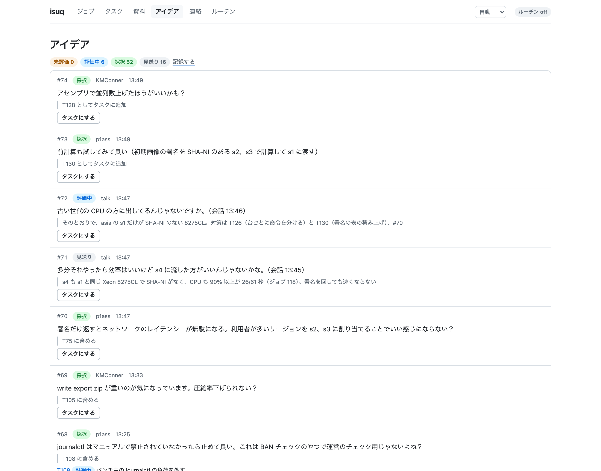
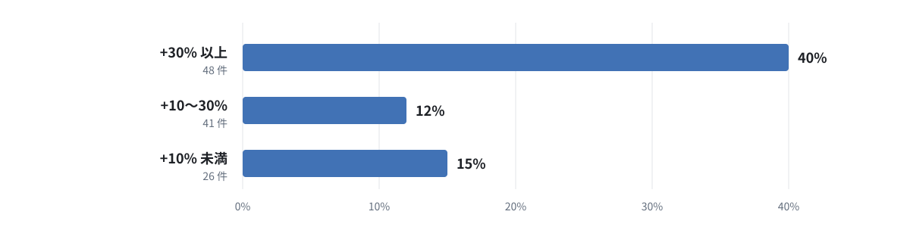

こんにちは、ぷらす([@p1ass](https://x.com/p1ass))です。

今年も [@km_conner](https://x.com/km_conner)、[@atrn0](https://x.com/atrn0) と一緒にチーム「釜中の鯖」として ISUCON2026 に参加しました。結果は**最終スコア 449,294 点**でした。

今年はコードの実装を全て Agent に任せ、人間は方針の判断に回る前提でハーネスを作り込んで臨みました。この記事では、ハーネスの基本構成や仕組みと、競技中にスコアを大きく伸ばした改善について紹介します。

_スコアの推移_

{/* <!--more--> */}

## 結果

| 項目               | 内容                                                                                                                                                                                                                                                                           |
| ------------------ | ------------------------------------------------------------------------------------------------------------------------------------------------------------------------------------------------------------------------------------------------------------------------------ |
| チーム             | 釜中の鯖                                                                                                                                                                                                                                                                       |
| メンバー           | [@p1ass](https://x.com/p1ass)、[@km_conner](https://x.com/km_conner)、[@atrn0](https://x.com/atrn0)                                                                                                                                                                            |
| 言語               | Go                                                                                                                                                                                                                                                                             |
| Agent              | Claude Code（Claude Opus 5.5）、サブとして Codex                                                                                                                                                                                                                               |
| 契約プラン         | Max 20x                                                                                                                                                                                                                                                                        |
| 順位               | 6 位                                                                                                                                                                                                                                                                           |
| 最終スコア         | 449,294 点                                                                                                                                                                                                                                                                     |
| 受賞               | freee 賞                                                                                                                                                                                                                                                                       |
| 競技中の最高スコア | 513,306 点（一度しか出ていない幻の値）                                                                                                                                                                                                                                         |
| 過去の参戦記       | [ISUCON 12 の予選に参加して、7位で本選進出を決めました](https://blog.p1ass.com/posts/isucon12/) [ISUCON 12 本選に参加しました](https://blog.p1ass.com/posts/isucon12-final/) [ISUCON13に参加して4位になりました (187,577点)](https://blog.p1ass.com/posts/isucon13/) |

競技中の最高スコアは 513,306 点でしたが、同じコードでベンチを回しても再現せず、幻の点数になってしまいました。この点数を最後に出せていれば 2 位に届いていたので惜しかったです。

また、企業賞の freee 賞をいただきました。最終スコアに同じ数字が 3 つ入っているチームに贈られる賞のようです。freee さん、ありがとうございます！

<Twitter url="https://twitter.com/atrn0/status/2116517330952044625" />

## 今年の問題

今年の問題は、写真を友達と共有する SNS「ISUReal」でした。
通知を受けたら決められた時間内に写真を投稿し、友達の写真を見て RealMoji（顔写真で付けるリアクション）を付けるサービスです。

_初期の構成のサーバーの配置_

サーバーは 4 台で、アプリの 3 台は別々のリージョンに置かれている設定でした。リージョン間の通信は遅延と帯域の制限がかかっています。

europe と america のユーザーは得点の倍率が 1.5 倍なので、海外のリージョンでどれだけ点を稼げるかがスコアを左右します。
ところが初期の構成では DB が asia の s4 にしかなく、海外のユーザーのリクエストは毎回リージョンをまたいでいてレイテンシーが悪化していました。
そのため、海外のリージョンから DB への通信をどう減らすかが序盤〜中盤の大きなテーマでした。

## ハーネスの構成

まずは、今年の ISUCON のために作ったハーネスの構成を紹介します。
ハーネスの中心は改善のループとジョブキューの isuq（ISUCON queue）です。

_ハーネスが回す改善のループ_

<Note kind="tip">
  このループは、私たちのチームが毎年人間の手で回していた改善の流れを、そのまま自動化したものです。
  ベンチの結果からボトルネックを探し、改善を実装して、またベンチで検証するという全体の流れは変えず、それぞれのステップを
  Agent に移譲しています。
</Note>

3 人はそれぞれの Mac で Claude Code を動かします。

_各担当の Mac で動く Agent_

実装のサブエージェントは、worktree で並行して実装します。以降ではこの改善ループを支える仕組みを順に紹介します。

### 設計の方針

ハーネスを設計するうえで一番のキーポイントは、**フロンティアモデルを使う Coding Agent があれば、ボトルネックは実装ではなくベンチになる**という考えです。

Agent はタスクに着手してから 10 分程度で実装を終え、キューにジョブを積んできます。
しかも実装のサブエージェントは並行して動くので、同時に何件も実装が進みます。
一方で、ベンチはチームで同時に 1 回しか回せず、1 回にはデプロイを含めて 2〜3 分かかります。
8 時間ずっと回し続けても 200 回ほどが上限です。

そこで、次の 3 つの方針でハーネスを設計しました。

| 目的                                           | 方針                                                                                                           |
| ---------------------------------------------- | -------------------------------------------------------------------------------------------------------------- |
| ベンチを途切れなく回し、1 回ずつ正確に計測する | 競技サーバー、ベンチ、main ブランチに書き込めるのを isuq だけにし、ジョブを 1 件ずつ途切れなく流す             |
| ベンチにはFAILしない変更だけを流す             | デプロイの検証、レスポンスの差分の検証、ブラウザでの確認を用意し、Agent が自分で正しさを検証できるようにする |
| 限られたベンチを効果の大きい改善に使う         | 人間はコードをほとんど書かず、マニュアルを原文で精読し、大きな方針を決め、ボトルネックを問い続ける               |

### isuq（ISUCON queue）

競技サーバー、ベンチマーカー、main ブランチはチームの全員で共有しています。
複数の Agent が同時にデプロイすると、ベンチがどのコードを計測したのか分からなくなります。
そこで、これらへ変更を isuq 経由のみに限定しました。

_isuq がジョブを処理する流れ_

Agent は worktree で作業し、isuq にジョブを送信します。
isuq はジョブを 1 件ずつ取り出してビルドし、全台にデプロイしてからベンチを回します。
スコアが直前の main と比較して指定したしきい値より高ければ main にマージし、届かなければレポートだけを返します。

キューの順番は画面やコマンドで並べ替えられます。
タスクを起票するときは、main のスコアに対して何 % 伸びるかを Agent に必ず見積もらせているので、適宜今のボトルネックの分析を元に順番を並び替えていました。

### ベンチのレポートと分析

ジョブが終わると、isuq はサーバーからアクセスログ、エラーログ、スロークエリログ、pprof を収集し、レポートを作成します。

また、サーバーごとのリソースのグラフも用意し、CPU 使用率の変化などをパッと把握できるようにしています。
グラフの上には、使用率の高いリソースを「ボトルネックの候補」として出しています。

_ジョブ 93 のリソースのグラフ_

<Note>
  ベンチのたびにログとプロファイルを計測する仕組み自体は、LLM が登場する前から
  ISUCON で使われていました。 私たちのチームもこれまでは
  [pprotein](https://github.com/kaz/pprotein)
  を使い、ベンチごとにアクセスログ、スロークエリログ、pprof を収集していました。
  計測の部分には新しさはなく、変わったのは Agent
  がそのデータを参照して次の改善につなげるところです。
</Note>

ただし、レポートは数字の羅列なので、そのままでは人間が方針を判断するための材料になりません。
そこで main が更新されるたびに分析のサブエージェントを起動し、ボトルネックの分析を人間向けの資料にまとめさせました。
当日は自動で起動した分析のサブエージェントが作成した資料だけで 63 件にのぼります。

_ジョブ 48 の分析の資料_

資料は「結論」「根拠」「次の手」の順で記述させています。
人間は資料の冒頭を確認するだけで即座に判断でき、気になる点があれば表やログまで遡って確認できます。

### 自動実行

人間が指示を出さなくても改善ループが止まらないように、isuq には時刻や条件で Agent に指示を出す自動実行の仕組みを用意しました。

| Skill         | 実行タイミング                        | 内容                                                     |
| ------------- | ------------------------------------- | -------------------------------------------------------- |
| analyst       | main に入ったときか予想外の結果のとき | ベンチの結果を分析する                                   |
| replenish     | 15 分ごと                             | 未着手のタスクが足りなければ、最新のレポートから起票する |
| e2e-full      | 30 分ごとか main が 10 回変わるごと   | ブラウザでの動作を確認し、壊したジョブを特定する         |
| wild-ideas    | 30 分ごと                             | よく知られた改善に縛られない大胆なアイデアを出させる     |
| freeze-config | 16:30                                 | サーバーの構成の変更を止める                             |
| finalize      | 17:00                                 | 計測を外し、仕上げの確認に入る                           |
| freeze        | 17:35                                 | 最終のコードで再起動試験を行う                           |

時刻や条件を満たすと、担当の Agent に指示が届きます。
各担当の Agent は別々の Mac で動いているので、指示のやり取りには isuq を使いました。
受信側はロングポーリングで isuq を待ち受けておき、指示が届くと起きて内容を確認します。
Agent どうしの依頼も、同じ仕組みで isuq を通して送信しています。

_Agent どうしのやり取り_

これにより、分析 → 起票 → 実装 → ベンチ → 分析というループが、人間の手を離れても自律的に回り続けます。

### ガードレール

Agent に任せる量が増えるほど、人間が目で誤りを拾いきれなくなります。
そこで、Agent が誤った変更を出しても main とベンチを守れるよう、フックと isuq の仕組みで次のガードレールを入れました。

| タイミング     | 仕組み                                                                                                    | 防ぐ失敗                                    |
| -------------- | --------------------------------------------------------------------------------------------------------- | ------------------------------------------- |
| 実装中         | Claude Code のフックで、main への push と、isuq のロックを持たないデプロイを拒否する                      | ほかの Agent のベンチ中にデプロイが割り込む |
| ジョブの投入時 | 同じファイルを変えたジョブがキューで待っていたら、投入を止める                                            | 待っている間にコンフリクトする              |
| ジョブの投入時 | 手元でビルド、単体テスト、初期実装とのレスポンスの差分の検証（presubmit）を流し、通るまで main に入れない | ベンチは通るが仕様と違う変更が入る          |
| デプロイ       | 全台のアプリがコミットの SHA を返すまで待つ                                                               | 古いバイナリのままベンチを回す              |
| ベンチの後     | 失格につながる画面の流れを Playwright で検証し（smoke）、落ちたら main を更新しない                       | ブラウザで動かない変更が入る                |
| ベンチの後     | スコアが main の 97% に届かなければ main に入れない                                                       | 気づかないうちにスコアが下がる              |

### ハーネスの評価 (eval)

ハーネスを改良しても、試せる本番は年に 1 回しかありません。
そこで、過去問を使ってハーネスの性能を評価する eval の仕組みを作りました。

eval では、過去問の環境を AWS 上に立ち上げ、本番と同じハーネス構成で方針担当と実装担当の 3 つの Agent を動かします。
人間は開始前のセットアップにしか関わらず、方針の判断も Agent に任せます。
ハーネスを改修したら同じ問題で 2 回以上回し、差がばらつきよりも大きいときだけ効果があったとみなしました。

| 問題     | 制限時間 | 人間 | 初期 → 最終スコア | ジョブ |
| -------- | -------- | ---- | ----------------- | ------ |
| ISUCON13 | 8 時間   | なし | 4,217 → 974,056   | 157    |
| ISUCON14 | 2 時間   | なし | 1,320 → 495,831   | 83     |

ISUCON13 の過去問では、人間が一度も関与せずに 8 時間で 974,056 点までスコアを伸ばせました。
環境が異なるため当時の公式スコアとは比べられませんが、人間がいなくてもループが回り続けることを確認できました。
本番ではこの自律ループの上に、人間が方針の判断を足します。

### 人間のアイデア

Agent だけでループを回すと、典型的な改善を積み上げるだけになりがちです。
大きな方針転換は人間に任せたほうがよいと考え、人間のアイデアをループへ取り込む仕組みを用意しました。

アイデアは isuq の画面、スマートフォン向けの画面、コマンドのどれからでも 1 行で投稿できます。
方針担当の Agent がアイデアを確認し、15 分以内に「採択」「評価中」「見送り」の判定と理由を返します。
採択されたアイデアはタスクとして起票され、各担当の Agent がコードを書きます。

_12:45 時点のアイデアの一覧_

当日はアイデアが 156 件集まり、95 件を採択しました。
返答までの時間は中央値で 8 分でした。
270 件のジョブのうち 107 件は、人間のアイデアや判断が起点となっています。

DB をリージョンごとに分割する改善も、署名の期限の切り上げも、人間の判断から始まりました。
Agent はマニュアルの「変えてはいけない」という記述に忠実なので、どこまで変えてよいかを人間が判断することで改善の幅が大きく広がります。

### 会話の文字起こし

競技中は 3 人で常に話しながら作業しています。
会話の中で決まったことやアイデアを、いちいち isuq に入力するのは手間がかかります。
そこで、@atrn0 の提案で、会話を文字起こしして自動で記録するようにしました。

_会話の文字起こしの流れ_

音声は 60 秒ずつ録音し、Mac 上の Qwen3-ASR（mlx-qwen3-asr）で文字起こしします。

方針担当の Agent は定期的にこの要約を参照ため、人間が口頭で決めたことが Agent にも自然と伝わるようになっています。

_12:15 までに会話から起票されたアイデアの一覧_

### ISUCON 以外への応用

isuq のジョブを処理する部分は、ISUCON に依存しない作りです。
ビルド、デプロイ、ベンチ、計測の取得は、どれも設定ファイルに記述したシェルのコマンドです。
ベンチのコマンドが最後の行で `{"score":N,"pass":bool}` を出力すれば、isuq はそのスコアで合否を判定します。
コマンドを差し替えれば、負荷試験のスループットや LLM の評価のスコアのように、変更を自動で数値にできるプロダクトの改善にも同じ仕組みを使えます。

### 開発に使った AI

ハーネスは 2026-10-12 から作り始め、本番前日までの 19 日間でほぼすべてのコードを Claude Code に書かせました。
コミット数は、記事を書いている時点で 1,161 件です。
この期間に私の Mac で使った量を [ccusage](https://github.com/ryoppippi/ccusage) で集計すると、eval と練習の分も含めて約 88.8 億トークン、API で払った場合の料金で約 2,787 ドルでした。
@km_conner と @atrn0 は Max 20x では途中で足りなくなり、Max（Ultra）に切り替えています。

## 振り返り

### 結局詰まり続けたキュー

ハーネスを設計するときは、ボトルネックは実装ではなくベンチになると考え、ベンチを途切れなく回して詰まらせない仕組みを作りました。
それでも当日は Agent の実装の速さにベンチが追いつかず、キューは昼過ぎからずっと詰まっていました。

_キューで待っていたジョブの数_

13 時以降は平均で 9〜11 件が常に待っていて、17:01 には最大の 16 件に達しました。
ジョブの待ち時間は中央値で 7.2 分、待ち時間の合計は 1,743 分で、ベンチが動いていた 397 分の 4 倍を超えています。

当日は 270 件のジョブを投入し、148 回のベンチを回しました。
最初のジョブから最後のジョブまでの間、ベンチが動いていた時間の割合は 86% です。
ベンチを途切れなく回すところまでは作れましたが、ベンチの待ちそのものを減らすところまでは手が回りませんでした。
競技後の分析では、ベンチ 1 回の所要時間を縮めれば、待ち時間の合計を 6 割前後減らせると見積もっています。
ボトルネックがベンチになることを見抜いていながら、それを解消しきれなかったことになります。

### 優先順位の付け方

キューが詰まっている以上、どのジョブにベンチの枠を使うかでスコアの伸びが決まります。

#### 見積もりによる優先順位

しかし実際には、ベンチの枠の多くが点を伸ばさないジョブに使われていました。
ベンチを回した 148 回のうち、main を 5% 以上伸ばしたのは 28 回で、この 28 回がスコアの伸びのほぼすべて（98%）を占めます。
49 回（33%）は差がブレの範囲に収まり、効果があったかどうかも分かりませんでした。

起票時の見積もりの区分ごとに、5% 以上伸びたジョブの割合を比べると次のとおりです。

_見積もりの区分ごとの、5% 以上伸びたジョブの割合_

見積もりが +30% 以上のジョブだけが 4 割の確率で当たり、スコアの伸びの 87% を占めていました。
キューが詰まっているときは、見積もりの大きい変更にベンチの枠を寄せるべきでした。

#### 人間による付け替え

人間が優先順位を付け替えた判断には、うまくいったものとそうでないものがありました。

うまくいったのは、PostgreSQL をリージョンごとに分割する変更です。
Agent の見積もりは「リスク高、効果 +20〜150%」と当たり外れの大きい変更でしたが、11:13 に私が最優先にするよう指示しました。
約 1 時間後の 12:20 には main に入り、スコアがほぼ倍（+93.6%）になりました。
構成を大きく変える判断は早いほど後の改善につながるので、ここを人間が引き受けたのは正解だったと思います。

一方で、ボトルネックを取り違えた可能性がある判断もありました。
キューが詰まっていたので、人間が「このジョブを先頭にしてほしい」と頼む場面が多く、並べ替えの依頼は約 190 件にのぼりました。
その判断材料にしていたのが isuq のレポートの「s1 の CPU が 90% 以上」という表示で、署名の計算など s1 の CPU を空ける変更を優先していました。

ところが競技の後に確認すると、isuq は CPU 使用率に iowait（ディスク待ち）を含めていました。
16:45 のジョブでは、s1 の CPU 使用率の内訳は user 30%、system 25%、iowait 40% で、半分近くはディスクを待っていた時間でした。
CPU を空ける変更を優先したことで、本当のボトルネックだったディスクへの対策が後回しになった可能性があります。
レポートを人間の判断材料にする以上、その数値の定義まで事前に確認しておくべきでした。

### 人間の差し込みの検証不足

本番までに回した eval の 10 回のうち、8 回は人間がまったく関わらない形で回しました。
人間なしでループが回り続けることの検証に力を入れた一方で、人間が途中で割り込んだときの動きはあまり試せていませんでした。

3 人がそろって人間役を務めた練習は、前日の 1 回だけです。
その練習での人間の発言とコマンドは 15 件でしたが、本番では 167 件に増えました。
Agent が人間への質問で止まった回数も、練習の 6 回（待ちの合計 7 分）に対して、本番は 28 回（同 70 分）でした。

本番では人間の差し込みに関わる次の問題も出ました。

- 「このジョブを先頭に」という並べ替えの依頼が約 190 件にのぼり、方針担当の Agent の手を取った
- 人間が横で開いた Claude Code のセッションが方針担当の受信箱からメッセージを取得し、キューの並べ替えまでして、方針担当の Agent とぶつかった
- 人間に判断を求めた項目が、返事のないまま流れた

人間なしで回ることを検証するだけでなく、人間が頻繁に割り込む前提の練習も eval に入れておくべきでした。

### Agent 時代の ISUCON

#### 分散したスコア

Agent が当たり前に使われるようになって、ISUCON の競技性が失われるのではないかと少し心配していました。
しかし実際には、[ポータルのスコアグラフ](https://portal.isucon.net/)を確認すると 1 位のチームがずば抜けていた一方で、ほかのチームのスコアは大きく分散していました。
どのチームも Agent を使っていたはずなので、差を生んだのは Agent を使うかどうかではなく、その使い方だったのだと思います。

#### 1 人チームの活躍

ハーネスを作っていた頃から、これならチームメンバーは 1 人でもよいのではと感じていました。
それでも、人間の発想やアイデアにはまだ大きな価値があり、3 人で考えるほうが有利だと考えていました。

蓋を開けてみると、やはり 1 人で参加したチームが上位に並びました。
上位 10 チームの人数は次のとおりです。

{/* <!-- textlint-disable ja-technical-writing/max-kanji-continuous-len --> */}

| 順位 | チーム                 | 人数 | スコア  |
| ---- | ---------------------- | ---- | ------- |
| 1    | Typing Bears           | 1 人 | 625,857 |
| 2    | ゲームセンターヤギ     | 1 人 | 475,546 |
| 3    | あとで                 | 1 人 | 464,395 |
| 4    | 54                     | 1 人 | 463,946 |
| 5    | Anago                  | 3 人 | 452,425 |
| 6    | 釜中の鯖（私たち）     | 3 人 | 449,294 |
| 7    | 新社屋2                | 3 人 | 436,993 |
| 8    | 注意欠如多動症認知特性 | 2 人 | 395,590 |
| 9    | じゅんぱい             | 1 人 | 336,479 |
| 10   | たつや                 | 2 人 | 311,396 |

{/* <!-- textlint-enable ja-technical-writing/max-kanji-continuous-len --> */}

上位 4 チームはすべて 1 人チームで、3 人で参加した私たちはこの 4 チームを上回れませんでした。
Agent が実装を並行して進めてくれるので、1 人でも何人分もの手数を出せるようになったのだと思います。
人数の多さが有利に働くとは限らない、というのが今年の結果でした。

#### human in the loop の楽しさ

1 位のチームが人間の手を介さない完全自律の Agent で優勝したのには驚きました。
それでも human in the loop 派の私たちにとって、Agent と一緒に課題へ取り組むのは純粋に楽しく、面白い体験でした。
Agent に任せれば単純に効率が上がる、というだけではありません。Agent が出してきた分析を踏まえて方針を考え直したり、人間のアイデアを Agent がすぐ形にしてくれたりと、一緒に考える楽しさがありました。
Agent が当たり前になっても、こうして人間と Agent が一緒にボトルネックと向き合うところに、ISUCON の面白さがあると感じています。

## おわりに

今年はハーネスを作り込んだおかげで、3 人で 148 回のベンチを回し、初期スコアの 100 倍以上まで伸ばすことができました。
一方で、1 位のチームには大きく差を付けられており、まだ改善の余地があると感じています。

ISUCON の作問や運営に携わった方々のおかげで、今年も ISUCON というお祭りを楽しめました。
今年は 8 時間を通してベンチが一度も止まらず、148 回のベンチを快適に回せました。ベンチを回し続ける前提のハーネスにとって、これは何よりありがたいことでした。
3 リージョンをまたいでデータをどこに置くかを考える、考えがいのある問題でした。
本当にありがとうございました。

## 付録：競技中に行った改善

ハーネスを使って競技中に入れた改善を紹介します。
8 時間で回したベンチは 148 回にのぼります。
すべてを取り上げると長くなるため、直前の main のスコアから 10% 以上伸びた改善に絞って紹介します。

<Note>当日のコードは、後日 GitHub で公開する予定です。</Note>

#### 10:29 インデックスを張る (3,965 → 6,411 点、+61.7%)

今年の初期スキーマもインデックスがほとんどありませんでした。
EXPLAIN でフルスキャンになっているクエリを洗い出し、15 個のインデックスをまとめて張りました。

#### 10:34 画像の取得のクエリをまとめ、画像データをキャッシュする (6,259 → 7,272 点、+16.2%)

画像の取得 API（`GET /api/images/:imageId`）は 1 リクエストで DB に 2 回クエリを発行していました。
クエリを 1 回にまとめ、画像データはメモリ上の LRU キャッシュで保持するようにしました。

#### 10:45 nginx で SSE の proxy_read_timeout を伸ばす (7,302 → 8,200 点、+12.3%)

通知の API（`GET /api/notifications`）は SSE で配信されます。
この API の p99 が 60.001 秒で、nginx の `proxy_read_timeout` のデフォルト値 60 秒とぴったり一致していました。

nginx で接続が切断され、再接続するまでの通知を取りこぼしていると考え、この API だけ `proxy_read_timeout` を 1 時間に伸ばし、`proxy_buffering` を off にしました。

#### 10:52 画像 URL の署名の計算を減らす (9,183 → 16,248 点、+76.9%)

画像の URL には署名が付いており、署名の計算は HMAC-SHA256 を 1000 回重ねる重い処理でした。
`hmac.New` の呼び出しを 1 回にして `Reset` で再利用し、計算した署名をメモリにキャッシュしました。

#### 11:21 ユーザーとセッションを 3 台のメモリに複製する (14,540 → 22,048 点、+51.6%)

海外の 2 台は、認証のたびに asia の DB と通信していました。
ユーザーと友達関係を 3 台のアプリのメモリに複製し、セッションは所属リージョンのサーバーでキャッシュして、認証時のリージョン間通信をなくしました。

書き込みがあったサーバーは変更を HTTP で他の 2 台に送り、2 台に反映が終わってからレスポンスを返します。
マニュアルで退会などの変更はすぐに反映するよう求められており、別のリージョンのサーバーで古いデータを返すと違反になるためです。

#### 11:32 投稿の API のクエリを pgx の Batch で 2 回の送信にまとめる (22,508 → 25,068 点、+11.4%)

投稿の API（`POST /api/posts`）はトランザクションの中で、ユーザーの行ロック、投稿期間の確認、投稿数の確認、INSERT などのクエリを 1 つずつ DB に送っており、9 回の通信が発生していました。
そこで pgx の Batch を使い、投稿できるかを確認するクエリと INSERT のクエリをそれぞれまとめて送ることで、通信を 2 回に減らしました。

#### 11:41 JPEG の検証でピクセルのデコードを省く (24,450 → 28,747 点、+17.6%)

投稿や RealMoji の画像は `jpeg.Decode` で全体をデコードし、縦横のサイズを確認しているだけでした。
判定結果を変えずに、ピクセルをデコードしない検証方法に切り替えました。

#### 11:46 SHA-256 を AVX2 で 8 つ同時に計算する (28,563 → 32,083 点、+12.3%)

署名のキャッシュを導入した後も、pprof では s1 の CPU の約 60% を署名の計算が占めていました。
サーバーはインスタンスの種類が違い、s1 は c5.large、s2 と s3 は c7i.large でした。
c7i の CPU には SHA 専用の命令（SHA-NI）があり、Go の標準ライブラリはこれを使って SHA-256 を高速に計算します。
一方、c5 の CPU には SHA-NI がないため、s1 だけ署名の計算が重くなっていました。

そこで、1 つのレスポンスに含まれる署名をまとめ、AVX2 のアセンブリで 8 つずつ同時に計算するようにしました。
s1 でベンチマークを計測したところ、標準ライブラリで 1 つずつ計算する場合の約 5 倍の高速化ができました。

#### 11:52 ユーザー検索で全ユーザーを DB から取得するのをやめる (33,337 → 38,760 点、+16.3%)

ユーザー検索の API（`GET /api/users`）は検索のたびに全ユーザーを LIMIT なしで DB から SELECT していました。
pprof では、この処理が s1 の CPU の約 12.5% を占めていました。

検索に使う名前の一覧をメモリに持ち、DB からは前回より後に登録されたユーザーだけを SELECT するようにしました。

#### 11:57 有効な投稿期間の投稿を 3 台のメモリに複製する (38,760 → 49,140 点、+26.8%)

投稿期間と、有効な期間の投稿、RealMoji、コメントを 3 台のメモリに複製し、フィードや投稿の詳細をメモリから返すようにしました。

#### 12:00 users の行ロックを緩める (49,140 → 58,137 点、+18.3%)

友達申請の承認やフォローなどの API は、双方の users の行に排他ロックを取っていました。
ロック待ちの 65% が承認とフォローだったため、2 人のユーザー ID をキーにした PostgreSQL の advisory lock に替えました。

#### 12:20 DB をリージョンごとに分割する (71,407 → 138,223 点、+93.6%)

s2 と s3 にも PostgreSQL が入っていたため、DB をリージョンごとに分割しました。

- `users` テーブルに `data_home` カラムを足して初回の所属リージョンを入れ、投稿、RealMoji、コメント、画像、通知、セッションはそのリージョンの DB に書き込む
- リージョンを移るユーザーのデータはそのままにする
- `/api/initialize` では 3 つの DB を並行して初期化する

海外のユーザーのデータをそのリージョンの DB で保持するようになり、スコアがほぼ倍になりました。

#### 12:40 署名の期限を 1 分単位に切り上げる (155,879 → 204,050 点、+30.9%)

画像 URL の署名は期限を含めて計算するので、期限が変わると署名も変わります。
期限は「今から 24 時間後」の秒単位だったため、同じ画像でも 1 秒ごとに署名が変わり、10:52 に入れたキャッシュは 1 秒間しかヒットしていませんでした。
期限を 1 分単位に切り上げることで、同じ画像の署名を 1 分間はキャッシュから再利用できるようになりました。

#### 13:36 投稿の fsync を行ロックの外に出す (226,495 → 257,042 点、+13.5%)

投稿の API は、画像をファイルに保存して fsync でディスクへの書き込みを待ってから、DB にコミットしています。
ただし、この 30ms ほどの fsync を、DB のコネクションと users の行ロックを持ったまま待ってしまっていました。
fsync をコネクションの取得より前に移し、待っている間にほかのリクエストを止めないようにしました。

#### 14:47 nginx の proxy_request_buffering を off にする (295,878 → 387,032 点、+30.8%)

s1 のディスク書き込みが毎秒 50MB ほど発生しており、iowait が出ていました。
書き込み量が受信量に近いことから、nginx が大きなリクエストボディを一時ファイルに書き込んでいると推測しました。
そこで、`/api/` に `proxy_request_buffering off` を追加し、リクエストボディをディスクへ書き込まずにアプリへ直接流すようにしました。

#### 16:45 ログインとログアウトから DB を外す (452,059 → 513,306 点、+13.5%)

この時点で s2 と s3 は CPU が頭打ちになっていました。
ベンチのユーザーは「ログイン → 過去の投稿の閲覧かエクスポート → 画像の取得 4 回 → ログアウト」を繰り返していたため、このベンチのシナリオから DB アクセスをなくすことを考えました。
所属リージョンのサーバーではログインとログアウトをメモリ上で処理し、セッションの書き込みは 200ms 単位でまとめて裏で DB へ流すようにしました。

これが競技中の最高スコアとなりましたが、同じコードを再計測すると 471,700 点で、それ以降は一度も 50 万点を超えませんでした。

#### 最終ベンチでのヒヤリハット

16:45 に 513,306 点を出した後、17 時台は次のようにバタついていました。

| 時刻         | 状況                                                                                                     |
| ------------ | -------------------------------------------------------------------------------------------------------- |
| 17:05        | 16:45 のコードを再計測すると 471,700 点で、513,306 点が再現しない。                                        |
| 17:11〜17:35 | 1 回だけ 495,000 点を出した変更を main に入れる。その後キューに積んだ 7 つの改善はすべてスコアが下がる。 |
| 17:49        | isuq の更新中にポータルからベンチを実行してしまい 0 点                                                   |
| 17:56        | 急いで復旧し、51 万点だったときのコミットに戻す                                                          |
| 17:57、17:59 | ポータルで最終ベンチを 2 回回し、2 回目の 449,294 点が最終スコアで終了。                                 |

最後にポータルでベンチを 2 回回し、2 回目の 449,294 点が最終スコアでした。

ギリギリまで改善を入れず、スコアを安定させることに時間を使っていたら 2 位の点数を超えられていたはずで、ベンチガチャの誘惑に勝てなかったドバガキだったなと反省しています。
