こんにちは、ぷらす([@p1ass](https://x.com/p1ass))です。

今年も [@km_conner](https://x.com/km_conner)、[@atrn0](https://x.com/atrn0) と一緒にチーム「釜中の鯖」として ISUCON2026 に参加しました。結果は**最終スコア 449,294 点**でした。

今年はコードの実装をすべて Agent に任せ、人間は方針の判断に回る前提でハーネスを作り込んで臨みました。この記事では、ハーネスの基本構成や仕組みと、競技中にスコアを大きく伸ばした改善について紹介します。

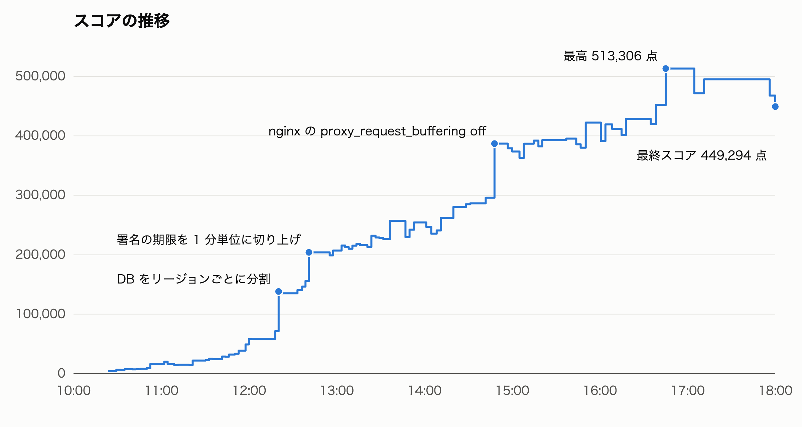
_スコアの推移_

{/* <!--more--> */}

## 結果

| 項目               | 内容                                                                                                                                                                                                                                                                           |
| ------------------ | ------------------------------------------------------------------------------------------------------------------------------------------------------------------------------------------------------------------------------------------------------------------------------ |
| チーム             | 釜中の鯖                                                                                                                                                                                                                                                                       |
| メンバー           | [@p1ass](https://x.com/p1ass)、[@km_conner](https://x.com/km_conner)、[@atrn0](https://x.com/atrn0)                                                                                                                                                                            |
| 言語               | Go                                                                                                                                                                                                                                                                             |
| Agent              | Claude Code（Claude Opus 5.5）、サブで Codex                                                                                                                                                                                                                                   |
| 契約プラン         | Max 20x                                                                                                                                                                                                                                                                        |
| 最終スコア         | 449,294 点                                                                                                                                                                                                                                                                     |
| 競技中の最高スコア | 513,306 点（一度しか出ていない幻の値）                                                                                                                                                                                                                                         |
| 過去の参戦記       | [ISUCON 12 の予選に参加して、7位で本選進出を決めました](https://blog.p1ass.com/posts/isucon12/) [ISUCON 12 本選に参加しました](https://blog.p1ass.com/posts/isucon12-final/) [ISUCON13に参加して4位になりました (187,577点)](https://blog.p1ass.com/posts/isucon13/) |

競技中の最高スコアは 513,306 点でしたが、同じコードでベンチを回しても再現せず、幻の点数になってしまいました。この点数を最後に出せていれば 2 位に届いていたので惜しかったです。

また、企業賞の freee 賞をいただきました。最終スコアに同じ数字が 3 つ入っているチームに贈られる賞のようです。freee さん、ありがとうございます！

<Twitter url="https://twitter.com/atrn0/status/2116517330952044625" />

## 今年の問題

今年の問題は、写真を友達と共有する SNS「ISUReal」でした。
通知を受けたら決められた時間内に写真を投稿し、友達の写真を見て RealMoji（顔写真で付けるリアクション）を付けるサービスです。

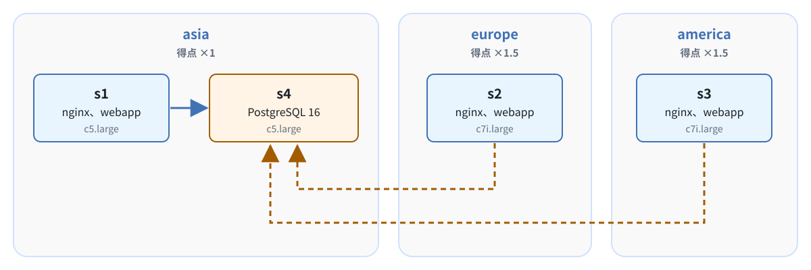
_初期の構成のサーバーの配置_

サーバーは 4 台で、アプリの 3 台は別々のリージョンに置かれている設定でした。リージョン間の通信は遅延と帯域の制限がかかっています。

europe と america のユーザーは得点の倍率が 1.5 倍なので、海外のリージョンでどれだけ点を稼げるかがスコアを左右します。
ところが初期の構成では DB が asia の s4 にしかなく、海外のユーザーのリクエストは毎回リージョンをまたいでいてレイテンシーが悪化していました。
そのため、海外のリージョンから DB への通信をどう減らすかが序盤〜中盤の大きなテーマでした。

## ハーネスの構成

まずは、今年の ISUCON のために作ったハーネスの構成を紹介します。
ハーネスは改善ループとジョブキューの isuq（ISUCON queue）をベースとしています。

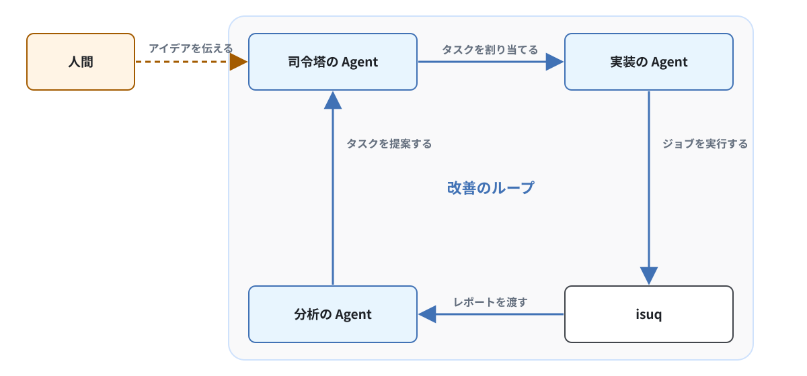
_ハーネスが回す改善のループ_

<Note kind="tip">
  このループは、私たちのチームが毎年人間の手で回していた改善の流れを、そのまま自動化したものです。
  ベンチの結果からボトルネックを探し、改善を実装して、またベンチで検証するという全体の流れは変えず、それぞれのステップを
  Agent に移譲しています。
</Note>

3 人はそれぞれの Mac で Claude Code を動かし、実装のサブエージェントは worktree で並行して実装してくれるようになっています。

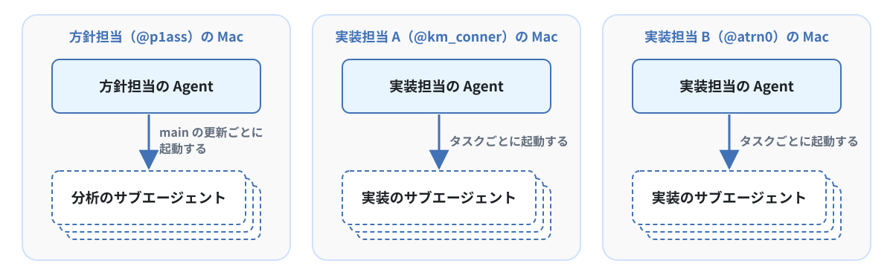
_各担当の Mac で動く Agent_

### 設計の方針

ハーネスを設計するうえで一番のキーポイントとしたのは、**フロンティアモデルで Coding Agent を動かせば、ボトルネックは実装ではなくベンチになる**という考えです。

Agent はタスクに着手してから 10 分程度で実装を終え、ジョブをキューに積んできます。
しかも実装のサブエージェントは並行して動くので、同時に何件も実装が進みます。
一方で、ベンチはチームで同時に 1 回しか回せず、1 回にはデプロイを含めて 2〜3 分かかります。
8 時間ずっと回し続けても 200 回ほどが上限です。

そこで、次の 3 つの方針でハーネスを設計しました。

| 目的                                           | 方針                                                                                           |
| ---------------------------------------------- | ---------------------------------------------------------------------------------------------- |
| ベンチを途切れなく回し、1 回ずつ正確に計測する | 競技サーバー、ベンチ、main ブランチへの変更を isuq 経由に限り、ジョブを 1 件ずつ順に処理する   |
| ベンチには FAIL しない変更だけを流す           | デプロイ、レスポンスの差分、ブラウザでの動作を、Agent が自分で検証できる仕組みを用意する       |
| 限られたベンチを効果の大きい改善に使う         | Agent に効果を見積もらせて順番を決め、Agent だけでは出てこない大きな方針の転換は人間が判断する |

### isuq（ISUCON queue）

競技サーバー、ベンチマーカー、main ブランチはチームの全員で共有しています。
複数の Agent が同時にデプロイすると、ベンチがどのコードを計測したのか分からなくなります。
そこで、これらへの変更を isuq 経由のみに限定しました。

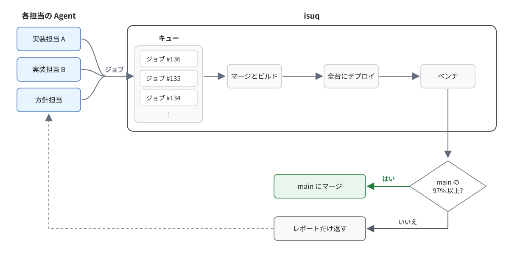
_isuq がジョブを処理する流れ_

Agent は worktree で作業し、isuq にジョブを送信します。
isuq はジョブを 1 件ずつ取り出してビルドし、全台にデプロイしてからベンチを回します。
スコアが直前の main と比較して指定したしきい値より高ければ main にマージし、届かなければレポートだけを返します。

キューの順番は Web UI やコマンドで並べ替えられます。
タスクを起票するときに、Agent に「main のスコアに対して何 % 伸びるか」を必ず見積もらせているので、今のボトルネックの分析を基に適宜順番を並べ替えられます。

### ベンチのレポートと分析

ジョブが終わると、isuq はサーバーからアクセスログ、エラーログ、スロークエリログ、pprof を収集し、レポートを作成します。

また、サーバーごとのリソースのグラフも用意し、CPU 使用率の変化などをパッと把握できるようにしています。
グラフの上には、使用率の高いリソースを「ボトルネックの候補」として出しています。

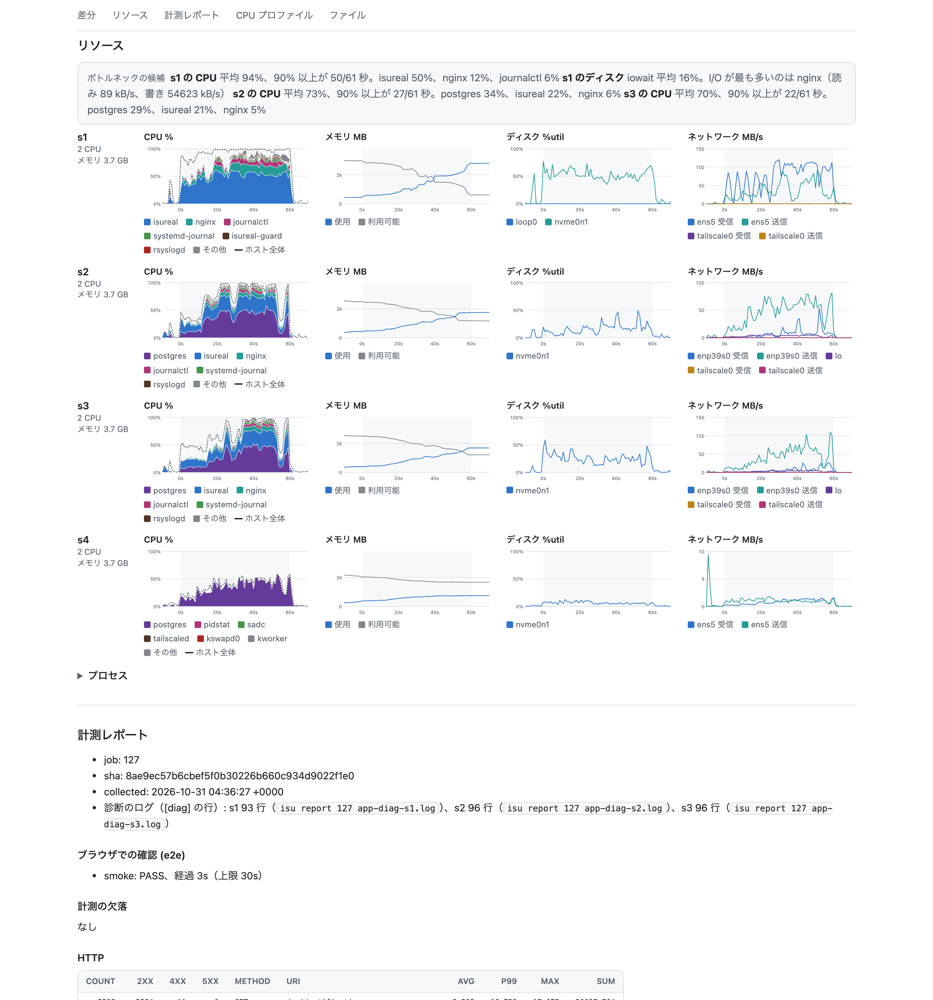
_とあるジョブのリソースのグラフ_

<Note>
  ベンチのたびにログとプロファイルを計測する仕組み自体は、LLM が登場する前から
  ISUCON で使われていました。私たちのチームもこれまでは
  [pprotein](https://github.com/kaz/pprotein)
  を使い、ベンチごとにアクセスログ、スロークエリログ、pprof を収集していました。
  計測の部分に新規性はなく、Agent
  がそのデータを参照して次の改善につなげるところが大きな差分です。
</Note>

ただし、レポートはあくまで事実を並べただけなので、そのままでは人間が方針を判断するためのサポートとしては弱いです。
そこで main が更新されるたびに分析のサブエージェントを起動し、人間向けのボトルネックの分析資料を作成させていました。

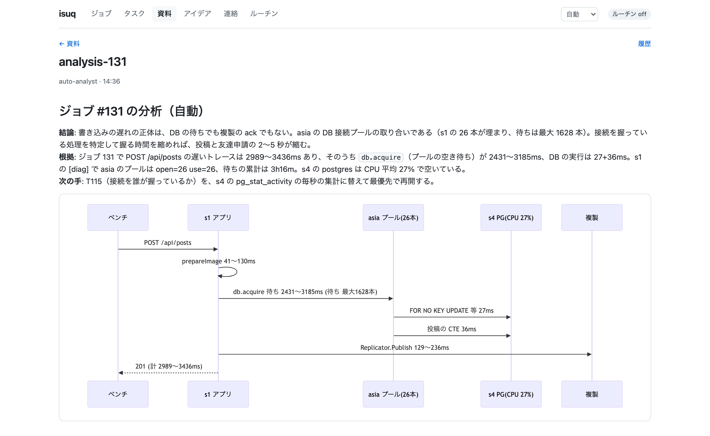
_とあるジョブの分析の資料_

人間は資料の冒頭を確認するだけで即座に判断でき、気になる点があれば表やログを遡って確認できます（読みやすさはまだまだ改善の余地があります）。

なお、Agent はこれらの資料を自動で参照するので、人間が介入しなくともベンチの結果に応じた改善を自動で実装してくれます。

### ベンチマーカーの分析

ジョブのレポートは 1 回のベンチの結果を分析するものですが、それとは別に、ベンチマーカーがどんな利用者をどう動かしているかを Agent に分析させる Skill も用意しました。
アクセスログ、ベンチマーカーのログ、DB の中身から、利用者の動きと点の入り方を推定させています。もちろん自分たちのサーバーで観測できるデータだけを使います。

この分析で今回の問題では、点が 2 つの流れ（シナリオ）から入っていることが分かりました。

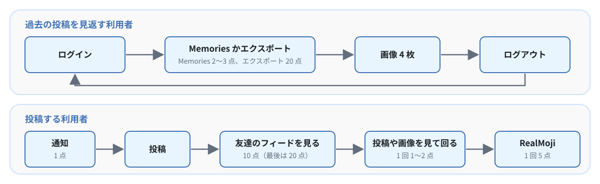
_2 つのシナリオ_

また、ベンチマーカーは投稿期間を 6 回繰り返しており、投稿する利用者数は前の投稿期間の結果に応じて決まることが分かりました。
投稿が間に合った利用者の 2 倍が、次の投稿期間に新規登録してきていました。

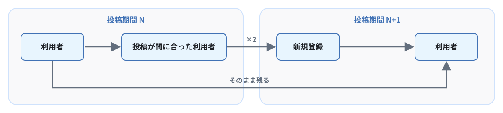
_投稿期間ごとの利用者の増え方_

逆にある投稿期間の取りこぼしは、次の投稿期間以降の利用者を減らしてしまいます。
次の図はとあるベンチの例で、4 回目の投稿期間に 80 人の投稿が間に合わず、その 2 倍の 160 人分の新規登録が減ってしまったことを表しています。

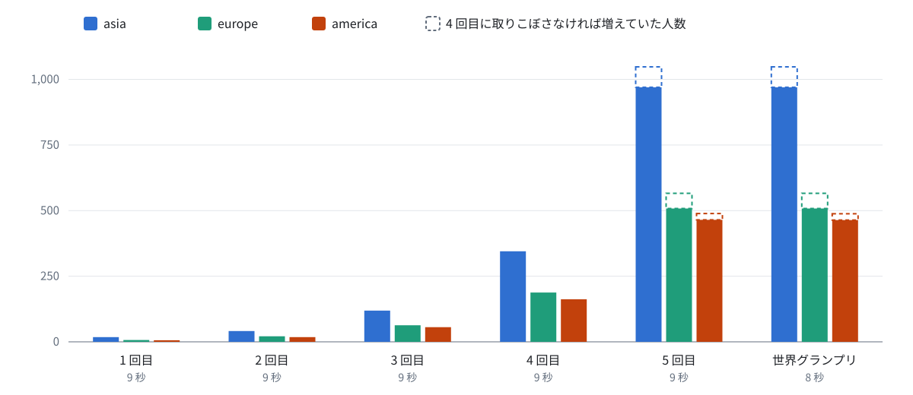
_分析したベンチの投稿期間ごとの利用者数_

### 自動実行

人間が指示を出さなくても改善ループが止まらないように、isuq には時刻や条件で Agent に指示を出す自動実行の仕組みを用意しました。

| Skill         | 実行タイミング                            | 内容                                                 |
| ------------- | ----------------------------------------- | ---------------------------------------------------- |
| analyst       | main に入ったときか予想外の結果だったとき | ベンチの結果を分析する                               |
| e2e-full      | 30 分ごとか main が 10 回変わるごと       | ブラウザでの動作を確認し、壊したジョブを特定する     |
| wild-ideas    | 30 分ごと                                 | よく知られた改善に縛られない大胆なアイデアを出させる |
| freeze-config | 16:30                                     | サーバーの構成の変更を止める                         |
| finalize      | 17:00                                     | 計測を外し、仕上げの確認に入る                       |
| freeze        | 17:35                                     | 最終のコードで再起動試験を行う                       |

時刻や条件を満たすと、担当の Agent に指示が届き、処理を実行します。
なお、各担当の Agent は別々の Mac で動いているので、ロングポーリングで待ち受けて isuq 経由でメッセージを受信します。
Agent どうしのメッセージも同じ仕組みで送信しています。

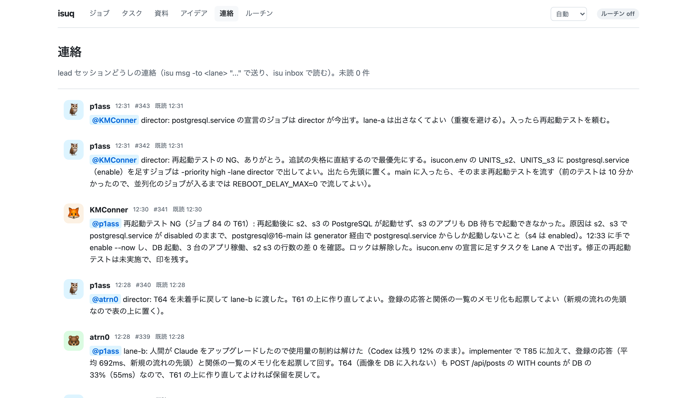
_Agent どうしのやり取り_

これにより、分析 → 起票 → 実装 → ベンチ → 分析というループが、人間の手を離れても自律的に回り続けるようになりました。

### ガードレール

ベンチは 1 回に 2〜3 分かかり、FAIL するとその分の時間を丸ごと無駄にします。
そこで、Agent が誤った変更を出してもベンチを消費しないように、フックと isuq の仕組みで次のガードレールを導入しました。

| 段階           | 起こりうる問題                                                                     | ガードレール                                                                                                |
| -------------- | ---------------------------------------------------------------------------------- | ----------------------------------------------------------------------------------------------------------- |
| 実装中         | ベンチを通していない変更が main に入る、ほかのジョブのベンチ中にデプロイが割り込む | Claude Code のフックで、main への直接の push と isuq のロックを持たないデプロイを拒否する                   |
| ジョブの投入時 | キューで待つ間に先に入った変更とコンフリクトする                                   | 同じファイルを変えたジョブがキューにあれば、投入を止める                                                    |
| ジョブの投入時 | ベンチは通るが仕様と異なる変更が入る                                               | 手元でビルド、単体テスト、初期実装とのレスポンスの差分の検証（presubmit）を実行し、通るまで main に入れない |
| デプロイ       | 古いバイナリのままベンチを回す                                                     | 全台のアプリが新しいコミットの SHA を返すまで、ベンチを始めない                                             |
| ベンチの後     | ブラウザで動かない変更が入る                                                       | 失格につながる画面の操作を Playwright で検証し、失敗したら main に入れない                                  |

### ハーネスの評価（eval）

ハーネスを改良しても試せる本番は年に 1 回しかありません。
そこで、過去問を使ってハーネスの性能を評価する eval の仕組みを作りました。

eval では、過去問の環境を AWS 上に立ち上げ、本番と同じハーネス構成で方針担当と実装担当の 3 つの Agent を動かします。
人間は開始前のセットアップにしか関わらず、方針の判断も Agent に任せます。

| 問題     | 制限時間 | 人間 | 初期 → 最終スコア | ジョブ |
| -------- | -------- | ---- | ----------------- | ------ |
| ISUCON13 | 8 時間   | なし | 4,217 → 974,056   | 157    |
| ISUCON14 | 2 時間   | なし | 1,320 → 495,831   | 83     |

ISUCON13 の過去問では、人間が一度も関与せずに 8 時間で 974,056 点までスコアを伸ばせました。
環境が異なるため当時の公式スコアとは比べられませんが、人間がいなくてもループが回り続けることを確認できました。
本番ではこの自動ループをベースに人間が方針の判断を足せるようにしています。

### 人間の役割

当日、人間が書いたコードはほぼ 0 行です。人間はマニュアルやサービスの理解と大きな方針の判断に集中しました。
Agent だけでループを回すと典型的な改善を積み上げるだけになりがちです。
大きな方針転換は人間に任せたほうがよいと考え、人間のアイデアをループへ取り込む仕組みを用意しました。

### 会話の文字起こし

競技中は 3 人で常に話しながら作業しています。
会話の中で決まったことやアイデアを、いちいち isuq に入力するのは手間がかかります。
そこで、@atrn0 の提案で、会話を文字起こしして自動で記録するようにしました。

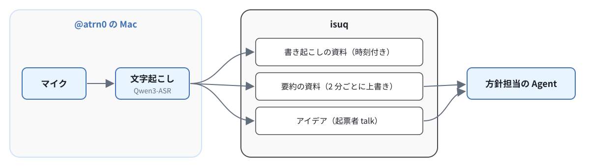
_会話の文字起こしの流れ_

音声は 60 秒ずつ録音し、Mac 上の Qwen3-ASR（mlx-qwen3-asr）で文字起こしします。

方針担当の Agent は定期的にこの要約を参照するため、人間が口頭で決めたことが Agent にも自然と伝わるようになっています。

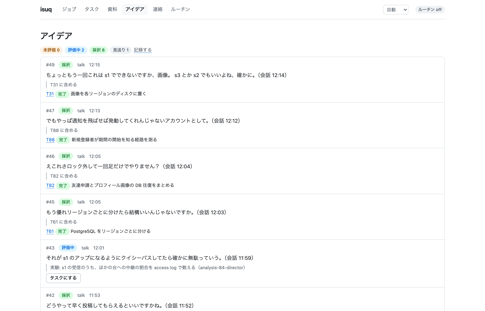
_アイデア一覧（文字起こしの精度はご愛嬌）_

### ISUCON 以外への応用

isuq のジョブを処理する部分は ISUCON に依存しない作りです。
ビルド、デプロイ、ベンチ、計測の取得は、どれも設定ファイルに記述したシェルコマンド経由で行われます。

そのため、コマンドを差し替えれば負荷試験のスループットや LLM の評価のスコアのような、定量的に評価できるプロダクトの改善にも同じ仕組みを使えます。

### 開発に使ったトークン

ハーネスは 2026-10-12 からちょくちょく作り始め、すべてのコードを Claude Code に書かせました。
この期間に使ったトークン量を [ccusage](https://github.com/ryoppippi/ccusage) で集計すると、eval と練習の分も含めて約 88.8 億トークン、API で払った場合の料金で約 2,787 ドルでした。
なお、サブスクリプションなので実際に払ったのは 200 ドルのみです。

## 本番を終えての振り返り

### 結局詰まり続けたキュー

ハーネスを設計するときは、ボトルネックは実装ではなくベンチになると考え、ベンチを途切れなく回して詰まらせない仕組みを作ったつもりでいました。
しかし、それでも当日は Agent の実装の速さにベンチが追いつかず、キューは昼過ぎからずっと詰まっていました。

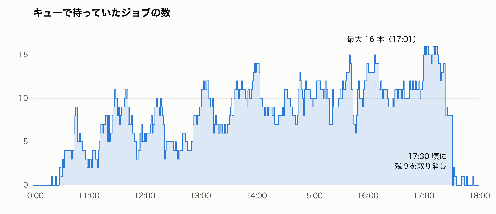
_キューで待っていたジョブの数_

13 時以降は、平均で 9〜11 件のジョブがキューで待っていました。
最初のジョブから最後のジョブまでの間、ベンチが動いていた時間の割合は 86% で、ベンチはほぼ途切れなく回せていました。
しかし、ベンチの待ちそのものは減らせませんでした。

ボトルネックがベンチになることを見抜いていながらそれを解消しきれなかったので、これは今後の改善ポイントだな〜と思っています。

### 限られたベンチの使い道

キューが詰まっている以上、スコアの伸びはベンチをどのジョブで回すかが重要になってきます。
しかし、スコアの伸びに大きく寄与したジョブは 148 回のうちの約 2 割程度でした。
また、スコアの伸びの約 3 分の 2 は、Agent が見積もったスコアの上昇率の予想が +30% 以上のジョブによるものでした。

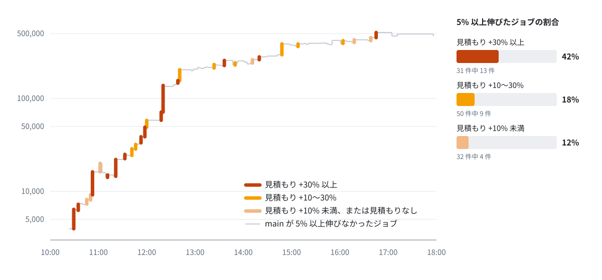
_main のスコアの推移（太線はスコアが 5% 以上伸びたジョブ）_

見積もりの精度にはまだまだ課題があるものの、キューが詰まっている状況なのであれば、見積もりの大きい変更をより優先してベンチを回すべきでした。
ハーネスには一部そのようなロジックが組み込まれていたものの不十分でした。

### 人間の役割はまだ残っていたのか？

当日、人間が書いたコードは 0 行でした。実装という観点では、人間の役割はもうない時代でしょう。

大きな方針の判断では、人間の役割が一部発揮できていました。
序盤、Agent はリージョンをまたぐ通信への対策として、データを各リージョンのメモリに複製する方針を立てていました。
一方で PostgreSQL をリージョンごとに分割する変更は、構成を大きく変えるリスクの高い選択肢として後回しにされていました。
しかし、それを私が最優先に引き上げたことで、スコアがほぼ倍になりました。
これは人間の判断がスコアに良い影響を与えたと言えるでしょう。
（最終的にはほとんどのデータをメモリに載せましたが）

一方で、細かいキューの並べ替えや割り込みは、かえって改善のループの足を引っ張っているときがありました。
人間がディスク I/O に起因する iowait の CPU 使用率を普通の CPU 負荷だと勘違いし、それを根拠にキューを並べ替えてしまったことで、本当のボトルネックの対策が後回しになってしまいました。
特に後半はディスク I/O が大きなボトルネックだったので、この読み間違えは手痛かったです。

そういうわけで「人間の役割は残っていたか？」と問われると、自信を持って YES とは言えないな〜と感じた 1 日でした。

### Agent 時代の ISUCON

#### 思ったより競技性が残っていた

Agent が当たり前に使われるようになって、ISUCON の競技性が失われるのではないか（スコアが横並びになるのでは？）と少し心配していました。
しかし実際には、[ポータルのスコアグラフ](https://portal.isucon.net/)を確認すると、スコアは結構ばらつきがありました。
多くのチームが Agent を使っていたはずなので、Agent の使い方や事前の準備が結果を左右していたと思っています。

特に 1 位のチームは完全自律型の Agent だったとのことで、大 Agent 時代を象徴する出来事でした。来年はどうなることやら。

#### 1 人チームの活躍がすごい

黙々とハーネスを作っていた頃から、「これならチームメンバーは 1 人でもよいのでは？」と感じていました。
それでも人間の発想やアイデアにはまだ大きな価値があり、3 人で考えるほうが有利だと考えていました。

しかし蓋を開けてみると、1 人で参加したチームが上位に並びました。

{/* <!-- textlint-disable ja-technical-writing/max-kanji-continuous-len, ja-spacing/ja-space-between-half-and-full-width --> */}

1. **Typing Bears（625,857 点、1 人）**
2. **ゲームセンターヤギ（475,546 点、1 人）**
3. **あとで（464,395 点、1 人）**
4. **54（463,946 点、1 人）**
5. Anago（452,425 点、3 人）
6. 釜中の鯖（私たち）（449,294 点、3 人）
7. 新社屋2（436,993 点、3 人）
8. 注意欠如多動症認知特性（395,590 点、2 人）
9. **じゅんぱい（336,479 点、1 人）**
10. たつや（311,396 点、2 人）

{/* <!-- textlint-enable ja-technical-writing/max-kanji-continuous-len, ja-spacing/ja-space-between-half-and-full-width --> */}

<ExLinkCard url="https://isucon.net/archives/isucon2026-teams.html" />

上位 4 チームはすべて 1 人チームです。
これまでも 1 人チームの優勝はありましたが、これだけ 1 人チームが上位に多いのは記憶にありません（違ったらすいません）。

Agent が実装を並行して進めてくれるので、1 人でも何人分ものアウトプットを出せるようになり、人数の多さが有利に働くとは限らない、というのが今年の結果でした。

#### Agent が実装していても ISUCON は楽しい

Agent と一緒に人間も課題へ取り組む形の ISUCON も面白かったな〜と思っています。

ISUCON の面白さは事前の練習の過程で新しい技術やアイデアを学んだり、当日に初見の問題に対して分析したり方針を考えたり、今年であればハーネスを作って試行錯誤したりするところにあると思っています。
もともと実装以外のところにも面白さの要素はたくさんあったので、そういった面白さは Agent が当たり前になった今でもまだまだ残っているな〜と感じました。

## おわりに

ISUCON の作問や運営に携わった方々のおかげで、今年も ISUCON を思う存分楽しめました。
今年は 8 時間を通してベンチが一度も止まらず、非常に快適なイベントでした。
皆様本当にありがとうございました！

## 付録：競技中に行った改善

ハーネスを使って競技中に入れた改善を紹介します。
すべてを取り上げると長くなるため、直前の main のスコアから 10% 以上伸びた改善に絞って紹介します。

<Note>当日のコードは、後日 GitHub で公開する予定です。</Note>

#### 10:29 インデックスを張る（3,965 → 6,411 点、+61.7%）

今年の初期スキーマもインデックスがほとんどありませんでした。
EXPLAIN でフルスキャンになっているクエリを洗い出し、15 個のインデックスをまとめて張りました。

#### 10:34 画像の取得のクエリをまとめ、画像データをキャッシュする（6,259 → 7,272 点、+16.2%）

画像の取得 API（`GET /api/images/:imageId`）は 1 リクエストで DB に 2 回クエリを発行していました。
クエリを 1 回にまとめ、画像データはメモリ上の LRU キャッシュで保持するようにしました。

#### 10:45 nginx で SSE の proxy_read_timeout を伸ばす（7,302 → 8,200 点、+12.3%）

通知の API（`GET /api/notifications`）は SSE で配信されます。
この API の p99 が 60.001 秒で、nginx の `proxy_read_timeout` のデフォルト値 60 秒とぴったり一致していました。

nginx で接続が切断され、再接続するまでの通知を取りこぼしていると考え、この API だけ `proxy_read_timeout` を 1 時間に伸ばし、`proxy_buffering` を off にしました。

#### 10:52 画像 URL の署名の計算を減らす（9,183 → 16,248 点、+76.9%）

画像の URL には署名が付いており、署名の計算は HMAC-SHA256 を 1,000 回重ねる重い処理でした。
`hmac.New` の呼び出しを 1 回にして `Reset` で再利用し、計算した署名をメモリにキャッシュしました。

#### 11:21 ユーザーとセッションを 3 台のメモリに複製する（14,540 → 22,048 点、+51.6%）

海外の 2 台は、認証のたびに asia の DB と通信していました。
ユーザーと友達関係を 3 台のアプリのメモリに複製し、セッションは所属リージョンのサーバーでキャッシュして、認証時のリージョン間通信をなくしました。

書き込みがあったサーバーは変更を HTTP でほかの 2 台に送り、2 台に反映が終わってからレスポンスを返します。
マニュアルで退会などの変更はすぐに反映するよう求められており、別のリージョンのサーバーで古いデータを返すと違反になるためです。

#### 11:32 投稿の API のクエリを pgx の Batch で 2 回の送信にまとめる（22,508 → 25,068 点、+11.4%）

投稿の API（`POST /api/posts`）はトランザクションの中で、ユーザーの行ロック、投稿期間の確認、投稿数の確認、INSERT などのクエリを 1 つずつ DB に送っており、9 回の通信が発生していました。
そこで pgx の Batch を使い、投稿できるかを確認するクエリと INSERT のクエリをそれぞれまとめて送ることで、通信を 2 回に減らしました。

#### 11:41 JPEG の検証でピクセルのデコードを省く（24,450 → 28,747 点、+17.6%）

投稿や RealMoji の画像は `jpeg.Decode` で全体をデコードし、縦横のサイズを確認しているだけでした。
判定結果を変えずに、ピクセルをデコードしない検証方法に切り替えました。

#### 11:46 SHA-256 を AVX2 で 8 つ同時に計算する（28,563 → 32,083 点、+12.3%）

署名のキャッシュを導入した後も、pprof では s1 の CPU の約 60% を署名の計算が占めていました。
サーバーはインスタンスの種類が違い、s1 は c5.large、s2 と s3 は c7i.large でした。
c7i の CPU には SHA 専用の命令（SHA-NI）があり、Go の標準ライブラリはこれを使って SHA-256 を高速に計算します。
一方、c5 の CPU には SHA-NI がないため、s1 だけ署名の計算が重くなっていました。

そこで、1 つのレスポンスに含まれる署名をまとめ、AVX2 のアセンブリで 8 つずつ同時に計算するようにしました。
s1 でベンチマークを計測したところ、標準ライブラリで 1 つずつ計算する場合の約 5 倍の高速化ができました。

#### 11:52 ユーザー検索で全ユーザーを DB から取得するのをやめる（33,337 → 38,760 点、+16.3%）

ユーザー検索の API（`GET /api/users`）は検索のたびに全ユーザーを LIMIT なしで DB から SELECT していました。
pprof では、この処理が s1 の CPU の約 12.5% を占めていました。

検索に使う名前の一覧をメモリに持ち、DB からは前回より後に登録されたユーザーだけを SELECT するようにしました。

#### 11:57 有効な投稿期間の投稿を 3 台のメモリに複製する（38,760 → 49,140 点、+26.8%）

投稿期間と、有効な期間の投稿、RealMoji、コメントを 3 台のメモリに複製し、フィードや投稿の詳細をメモリから返すようにしました。

#### 12:00 users の行ロックを緩める（49,140 → 58,137 点、+18.3%）

友達申請の承認やフォローなどの API は、双方の users の行に排他ロックを取っていました。
ロック待ちの 65% が承認とフォローだったため、2 人のユーザー ID をキーにした PostgreSQL の advisory lock に替えました。

#### 12:20 DB をリージョンごとに分割する（71,407 → 138,223 点、+93.6%）

s2 と s3 にも PostgreSQL が入っていたため、DB をリージョンごとに分割しました。

- `users` テーブルに `data_home` カラムを足して初回の所属リージョンを入れ、投稿、RealMoji、コメント、画像、通知、セッションはそのリージョンの DB に書き込む
- リージョンを移るユーザーのデータはそのままにする
- `/api/initialize` では 3 つの DB を並行して初期化する

海外のユーザーのデータをそのリージョンの DB で保持するようになり、スコアがほぼ倍になりました。

#### 12:40 署名の期限を 1 分単位に切り上げる（155,879 → 204,050 点、+30.9%）

画像 URL の署名は期限を含めて計算するので、期限が変わると署名も変わります。
期限は「今から 24 時間後」の秒単位だったため、同じ画像でも 1 秒ごとに署名が変わり、10:52 に入れたキャッシュは 1 秒間しかヒットしていませんでした。
期限を 1 分単位に切り上げることで、同じ画像の署名を 1 分間はキャッシュから再利用できるようになりました。

#### 13:36 投稿の fsync を行ロックの外に出す（226,495 → 257,042 点、+13.5%）

投稿の API は、画像をファイルに保存して fsync でディスクへの書き込みを待ってから、DB にコミットしています。
ただし、この 30ms ほどの fsync を、DB のコネクションと users の行ロックを持ったまま待ってしまっていました。
fsync をコネクションの取得より前に移し、待っている間にほかのリクエストを止めないようにしました。

#### 14:47 nginx の proxy_request_buffering を off にする（295,878 → 387,032 点、+30.8%）

s1 のディスク書き込みが毎秒 50MB ほど発生しており、iowait が出ていました。
書き込み量が受信量に近いことから、nginx が大きなリクエストボディを一時ファイルに書き込んでいると推測しました。
そこで、`/api/` に `proxy_request_buffering off` を追加し、リクエストボディをディスクへ書き込まずにアプリへ直接流すようにしました。

#### 16:45 ログインとログアウトから DB を外す（452,059 → 513,306 点、+13.5%）

この時点で s2 と s3 は CPU が頭打ちになっていました。
ベンチのユーザーは「ログイン → 過去の投稿の閲覧かエクスポート → 画像の取得 4 回 → ログアウト」を繰り返していたため、このベンチのシナリオから DB アクセスをなくすことを考えました。
所属リージョンのサーバーではログインとログアウトをメモリ上で処理し、セッションの書き込みは 200ms 単位でまとめて裏で DB へ流すようにしました。

これが競技中の最高スコアとなりましたが、同じコードを再計測すると 471,700 点で、それ以降は一度も 50 万点を超えませんでした。

#### 最終ベンチでのヒヤリハット

16:45 に 513,306 点を出した後、17 時台は次のようにバタついていました。

| 時刻         | 状況                                                                                                     |
| ------------ | -------------------------------------------------------------------------------------------------------- |
| 17:05        | 16:45 のコードを再計測すると 471,700 点で、513,306 点が再現しない。                                      |
| 17:11〜17:35 | 1 回だけ 495,000 点を出した変更を main に入れる。その後キューに積んだ 7 つの改善はすべてスコアが下がる。 |
| 17:49        | isuq の更新中にポータルからベンチを実行してしまい 0 点                                                   |
| 17:56        | 急いで復旧し、51 万点だったときのコミットに戻す                                                          |
| 17:57、17:59 | ポータルで最終ベンチを 2 回回し、2 回目の 449,294 点が最終スコアで終了。                                 |

最後にポータルでベンチを 2 回回し、2 回目の 449,294 点が最終スコアでした。

ギリギリまで改善を入れず、スコアを安定させることに時間を使っていたら 2 位の点数を超えられていたはずで、ベンチガチャの誘惑に勝てなかったドバガキだったなと反省しています。
